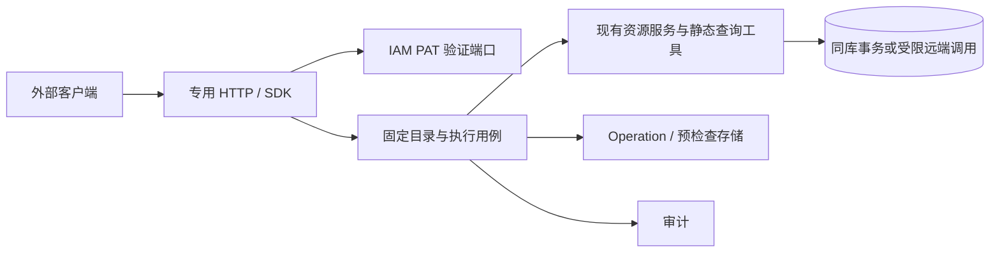

# 外部 MCP：实现设计

版本 v0.10，2026-10-29。功能分支 `feat/external-mcp-pat`。

需求：[PRD-011](../requirements/PRD-011-external-mcp.md)。决策：[ADR-036](../design/ADR-036-external-mcp-pat.md)。部署与客户端配置：[接入指南](../install/external-mcp.md)。

## 入口与身份

`POST /api/v1/integrations/mcp` 使用 `Authorization: Bearer <PAT>`。不接受查询参数凭证、浏览器 JWT 或上游第三方凭证。官方 `github.com/modelcontextprotocol/go-sdk v1.8.0` 提供初始化、版本协商、通知、工具发现和调用。采用无状态 JSON 响应；GET/DELETE 返回 405，无主动 SSE。

PAT 管理使用原 JWT 保护组：GET/POST `/api/v1/iam/mcp-tokens`，PUT/DELETE `/api/v1/iam/mcp-tokens/{public_id}`。创建与编辑输入为 `name`、`scopes`、可空 `expires_at`。空值表示不过期，新设到期时间必须为未来时间；编辑允许保持原到期时间。编辑保留原 Token 值，当前权限在新请求、查询结果释放前和排队任务执行前重新校验。删除会移除凭证记录并立即阻断后续鉴权；列表和编辑响应不包含 secret/hash。

令牌格式 `ogmcp_<16 bytes public hex>.<32 bytes secret hex>`。数据库只存 secret 的 SHA-256，用常量时间比较。当前用户必须 active 且 role=admin；执行 worker 不信任受理时的角色快照。令牌仅有部署范围权限，不提供成员资源隔离。

## 模块与调用链

- `internal/iam/{biz,data}/integrationtoken`：令牌生命周期与当前身份。
- `internal/manager/{biz,data,server,service}/externalmcp`：目录、协议、资源适配和持久执行。
- `internal/pkg/integrationauth`：跨域身份契约；`dbx`：显式事务及提交后回调。
- `cmd/ongrid/bootstrap_external_mcp.go`：跨域接口装配，iam 与 manager 不互相 import。

## 工具与策略

原有查询工具保留 `query_devices`、`get_host_summary`、`query_incidents`、`get_incident_detail`、`list_metric_catalog`、`query_promql`、`query_k8s_snapshot`、`describe_k8s_resource`、`query_logql`、`query_traceql`，另有设备、规则、面板详情/列表及 `get_operation`、`cancel_operation`。依赖未注册的静态工具不导出；不导出动态 ToolBag、任意 Shell/文件或第三方 MCP 透传；Agent 与 Skill 的产品 API 使用独立 scopes，并在操作页确认。完整平台覆盖见 [MCP 能力覆盖](external-mcp-coverage.md)。

| 写工具 | scope（另需对应 read） | 执行策略 |
| --- | --- | --- |
| `update_device` | `devices:write` | 名称、说明、角色和 environment 按权限修改 |
| `delete_device` | `devices:delete` | 仅离线设备；操作页确认后执行；删除关联 Edge 身份；不会卸载 Agent |
| `update_incident` | `alerts:write` | ack/resolve/silence；静默 `until` 为未来且最多 30 天 |
| `manage_alert_rule` | `alert-rules:write/delete` | create 直接执行；update/set_enabled/delete 在操作页确认后执行 |
| `manage_monitor_panel` | `monitor:write/delete` | 单面板 CRUD；Grafana 异步同步 |
| `host_restart_service` | `host:execute` + `devices:read` | 现有服务白名单，操作页确认后执行 |
| `execute_k8s_action` | `k8s:write/delete/execute` | 持久预检查、资源版本及操作页确认 |

K8s scale 使用 write，delete_pod 使用 delete，其余动作使用 execute。所有 K8s 真实写入先返回直达链接，用户在 Ongrid 操作确认页确认一次后执行；打开链接本身不执行。force/disable_eviction/delete_emptydir_data 另需 delete。dry-run 必须由真实 controller 成功响应，5 分钟凭据绑定账号、PAT、参数和 resourceVersion，数据库 CAS 消费一次。

### 确认范围

服务端使用明确的低风险白名单，客户端不能传入 `confirmed` 或风险级别改变决策。所有动作保留 PAT 权限、幂等、审计与原有版本检查。

| 无需确认 | 范围 |
| --- | --- |
| 普通新建 | 监控面板、告警规则、拓扑节点/关系、聊天会话 |
| 改名或说明 | 设备仅 name/description；面板仅 title；拓扑节点仅 name；会话仅 title |

同一请求带入其他修改字段时仍需确认。删除、重启、K8s 动作、升级、权限、凭据、环境和运行配置变更、消息发送，以及尚未分类的动作继续确认。拓扑节点类型和关系类型接口可覆盖已有类型，因此一律需要确认。工作流创建默认启用，可能触发执行；不属于普通新建。知识文档更新接口要求完整正文并替换元数据，当前无法单独改标题，因此不放行其覆盖写。规则更新同样替换完整配置，只有新建规则免确认。

`describe_api_operation.approval_required` 在未提供 body 时给出保守结果；参数相关的最终决定以 `dry_run` 返回的 `approval_required` 为准。旧 awaiting_approval 记录保留原确认要求；重试旧幂等键不会把它转为直接执行。

规则支持已实现的 metric_threshold、metric_raw、metric_anomaly、metric_forecast、metric_burn_rate、log_search。更新是完整替换可编辑 payload，需先读详情。旧 trace/log 占位类型没有执行语义，本入口拒绝它们。规则 dry-run 使用共享验证与预览，不执行历史回放；不声称已进行完整 PromQL 语法和查询成本证明。

## 幂等与恢复

每次真实写入需 `idempotency_key`，8–128 字节；同 PAT 下键经哈希后唯一。同键相同规范化参数返回原 Operation，不同参数返回 `IDEMPOTENCY_CONFLICT`。静默截止时间校验在已有幂等记录恢复后执行；新请求与 dry-run 仍校验未来 30 天内的截止时间，实际执行前仍拒绝已过期的静默。未知结果不能通过换键重试。

设备、告警、规则、面板的读取返回 `revision`。更新/删除比较 `expected_revision`；在事务内先取得资源行锁，保护检查到修改之间的窗口。参与路径通过 `dbx.WithContext` 共享事务。现有普通 REST 入口仍保持原语义，事务锁只保证 MCP 自身不越过同时发生的提交。

Operation 状态：普通创建和改名从 queued 开始；需要确认的动作从 awaiting_approval 开始，确认后进入 queued；后续为 running → succeeded/failed/partial/unknown。受理时原子保存 Operation 与审计，仅需要确认的动作同时保存 Approval；同一幂等键返回同一记录。`approval_url` 为 `/approvals/{approval_id}`，登录后返回该页面。页面显示目标、脱敏参数和风险；单击“确认并执行”调用现有管理员审批接口，不再弹第二个确认框。只读打开、拒绝和关闭页面均不执行。PAT 不能调用审批决定。无需确认或确认后的同库动作立即执行；API 与远端动作入持久队列，页面轮询展示真实 Operation 状态。worker 执行前仍校验当前权限与版本；旧 pending 记录不自动批准。queued 和 awaiting_approval 可取消。

数据库锁将同一 PAT 及同一目标串行化。执行预算 11 分钟、租约 12 分钟；worker 每 2 秒检查。租约丢失标记 unknown，不盲目重放。远端响应仅表示 accepted_by_remote；健康与就绪需另行检查。完成审计失败标记 audit_pending，保留已执行事实并后台补写，暂不释放结果数据。

终态且完成审计的 succeeded/failed/cancelled/partial 记录保留至少 30 天，每小时每批最多清理 1000 条；unknown、待执行、待审批和待补审计记录保留。过期预检查与租约清理。删除 PAT 不删除历史 Operation 和审计，它们保留 PAT public ID；旧版本已撤销的凭证保持失效并从列表隐藏。业务数据库备份仍按现有部署策略执行。

## 结果、审计与预算

查询返回 schema_version、request_id、status、observed_at、source、authorization_scope=deployment、data、completeness、truncated、warnings。实际查询时间范围在 data.time_range；分页数量保留在 data 内。数据库采集时间不改写为请求时间。

默认 completeness=unknown。逐项错误、已知截断和 stale 标记使结果变为 partial。空结果不证明健康或全量覆盖；有限候选集查询附 CANDIDATE_WINDOW_LIMITED。K8s 详情仅暴露必要 spec/status，删除原始对象、环境、annotations、凭证键和链路 attributes。自由文本做常见密钥模式遮盖和 8 KiB 截断；模式不能识别所有业务机密，日志/链路 scope 仍须按数据外发范围授权。

MCP 同时返回 structuredContent 与相同 JSON 的文本副本。执行错误使用 isError 与稳定 error_code。写入返回 Operation ID、state、applied（三态）、verification、next_action、approval_url（待确认时 next_action=open_approval_url）；failed/cancelled 表示未应用，unknown 表示无法确认。同步同库操作在事务内读回，远端成功不代表健康。

审计使用 `mcp_token_create`、`mcp_token_update`、`mcp_token_delete`、`mcp_call`；记录 owner、PAT public ID、request/operation ID、阶段、固定工具名、结果码。受理事件含目标、摘要与版本，查询完成含耗时、返回大小和参数哈希；不存查询原文。PAT 创建、编辑与审计同事务；删除先落库，审计故障不能恢复令牌权限。原有 `Emit` 行为保持不变。

HTTP 64 KiB，参数 60 KiB，持久写请求 48 KiB；查询 20 秒，HTTP 25 秒；结构化结果 120 KiB，含文本副本和协议封装小于 256 KiB。列表通常默认 20、最大 100，日志最大 200，主机概况 1–10 个 DeviceID，日志/链路搜索时间窗最多 24 小时。后端保留原有限制，部署仍需设置查询后端计算预算。

每实例：已认证的只读查询、工具发现和状态轮询不限制每分钟次数。每 PAT 并发 10、同一 owner 合计并发 20、MCP HTTP 总并发 40（包含认证阶段）。写工具每 PAT 120/min，burst 20；dry_run 仍计入写工具额度，限流结果标记 retryable=true。这里的并发仅限制入口请求，不扩大持久化 Operation worker 的执行并发。

认证失败响应与审计按实际连接 IP 60/min、burst 30 限制；额度用完返回 429，不影响同代理 IP 下合法 PAT。身份验证仍在 40 个全局并发名额内完成，这不是认证前的请求频率限额。仅使用连接 IP，不信任客户端伪造的转发 Header。只读查询随 HTTP 请求取消或到期停止；已受理写操作保留原持久化恢复语义。所有计数均在单实例内存，多实例不共享额度。

拒绝指标分别使用 authentication_rate_limit、identity_concurrency、global_concurrency 和 write_rate_limit，便于区分故障来源。并发拒绝仍返回 429 和 Retry-After；权限、高风险确认、幂等、审计、超时和请求大小限制保持不变。

新增低基数指标：ongrid_external_mcp_calls_total、ongrid_external_mcp_call_duration_seconds、ongrid_external_mcp_rejections_total、ongrid_external_mcp_result_bytes。认证/限流失败不包含请求凭证；数据库整体故障的恢复以持久 Operation 为准。

## 本地验证与发布边界

测试覆盖 SQLite/MySQL 迁移、幂等并发、参数冲突、版本冲突、事务回滚、PAT 归属、确认前不执行、单次确认、重复确认与审批恢复、预检查单次消费、远端超时不重放、写暂停后的状态查询、保留策略及 HTTP SDK 协议隔离。前端验证创建/不过期、失败保留输入、一次性 secret、编辑权限与保持到期时间、取消删除，并检查双语、深浅主题和四档宽度。

本机 WorkBuddy 5.9.3 已验证连接及工具发现；未在真实豆包工作账号、实际 controller 或生产资源上验收，未通过 WorkBuddy 执行真实资源动作，未做容量压测。这些是启用生产写能力前的发布验证项。详细命令和环境结果见 [验证记录](../testing/external-mcp.md)。

## 平台能力扩展（v0.6）

新增固定 API 操作目录，覆盖 APM、拓扑、网络、知识库、工作流、报告、Agent、Skill、平台配置和管理等模块。复用控制台的 protected handler 注册函数与角色校验，由 PAT 身份替代 JWT 入口；不创建内部 JWT，不允许任意 URL。新增 API 写操作按风险决定是否进入操作确认页，请求始终加密保存，并用 accepted_by_api / unknown 明确表达非原子结果。字段与边界见[完整能力覆盖](external-mcp-coverage.md)。
