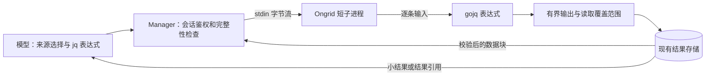

# 大结果的流式表达式分析

状态：2026-11-17 已接入代码并部署到本机测试环境。真实模型完成六类合成业务问答；验收范围、失败尝试和内存测量见[验收记录](../test/tool-result-analysis-20261117.md)。

## 选择与范围

保留已有结果存储、压缩、会话鉴权及读取界面，增加 `analyze_tool_results(inputs, expression)`。模型使用纯 Go 的 gojq 编写数据表达式；Manager 按需启动同一个 Ongrid 程序的短子进程，用完退出。无需 V8、Node、Python 分析运行时、独立 broker、分析容器或 Docker socket。

表达式可以组合筛选、统计、分组、排序和关联。它不提供完整 Python/JavaScript 环境，也不执行其他工具。文本语义归纳仍需模型读取相关内容；本次未实现全量语义分批分析。

## 数据路径



每份输入指定结果 ID、格式和 JSON Pointer，不接受文件路径。Manager 验证所有来源权限、过期状态和完整性后，使用已有块读取器传输数据，不整体 `ReadAll` 或 Base64 编码。子进程逐条解析原生 JSON 数组，也能流式解码 MCP `content[].text` 内的 JSON/CSV。CSV 使用 Go 标准库；普通文本按行传入。

jq `inputs` 只迭代一次，按来源顺序产生 `{source, value}`。例如：

```jq
reduce inputs as $r ({total:0,cost_cents:0};
  .total += 1 | .cost_cents += $r.value.cost_cents)
```

每条 JSON 记录用 `UseNumber` 解码，大整数保持精确。CSV 列保持字符串，表达式显式使用 `tonumber`。金额使用整数最小单位；浮点函数不保证十进制精度。

输出记录表达式、来源 ID/选择/哈希、退出状态、时长及每份来源的 `records_read` 和 `complete`。读取前缀时 `complete=false`；解析错误不能被 jq `try` 隐藏为成功证据。读取到末尾只证明迭代完成，不能证明字段选择和计算逻辑正确。输出超过模型视图上限时，仍通过已有结果引用读取。

## 内存与失败边界

流式输入避免保留整份原文和完整解码数组。筛选、计数、求和、固定数量分组和有限 Top N 可以保持有界状态；`[inputs]`、全量排序、去重和关联仍会保存中间数据。

gojq 反复更新不断增大的对象可能产生大量复制。真实模型验证中，这种关联写法触发内存上限。工具说明明确要求先只保留必要字段，再使用 `group_by`；内存错误返回简短原因和修正建议，不鼓励并行重复同一失败方案。该指导改善了本组用例，不保证任意规模关联成功。

| 资源 | 当前限制 |
| --- | --- |
| 输入 | 1–4 份，合计 64 MiB |
| 单条记录 | 1 MiB |
| 表达式 / 输出 | 16 KiB / 64 KiB |
| 执行时间 | 5 秒 |
| 并发 / 调用 | 每个 Manager 同时 2 次，每次模型运行最多 6 次 |
| Linux 分配限制 | `RLIMIT_DATA=384 MiB`，Go GC 软目标 256 MiB，禁用 core dump |

子进程在加载 Manager 配置、数据库和服务之前分流。环境不继承业务凭据；已有依赖的初始化缓存写入 Runner 的临时工作目录，结束后清理。父进程负责超时、取消、进程组回收和输出上限。不启用 gojq 的模块、环境、文件、网络或外部工具能力。

`RLIMIT_DATA` 不是精确 RSS 上限，`GOMEMLIMIT` 也不是硬隔离。这是受限数据解释器和独立进程，不宣称具备 VM 级防护或能抵御解释器漏洞。非 Linux 环境不注册分析工具；设置资源限制失败时不执行表达式。此次运行验证为 Linux arm64，amd64 尚需独立运行验收。

## 运维与验证

结果捕获和 Linux 分析始终开启，不增加部署服务或启停配置。表达式参数经既有 AutoMigrate 扩为 LONGTEXT，避免 JSON 转义后超过 TEXT 容量。来源和派生结果继续遵循现有保留期；删除会话尚不立即清除载荷。

保留数据库、LONGTEXT 列和结果卷；旧版本可能缩列，不能直接当作安全回滚目标。详细操作见[安装说明](../install/tool-results.md#streaming-result-analysis)。

可复现的只读 MCP、自然语言问题、独立 SQLite 答案核对、Linux worker 边界检查和内存测量位于 [scripts/result-analysis](../../scripts/result-analysis/README.md)。它们使用合成项目数据，不构成生产业务或容量验收。
