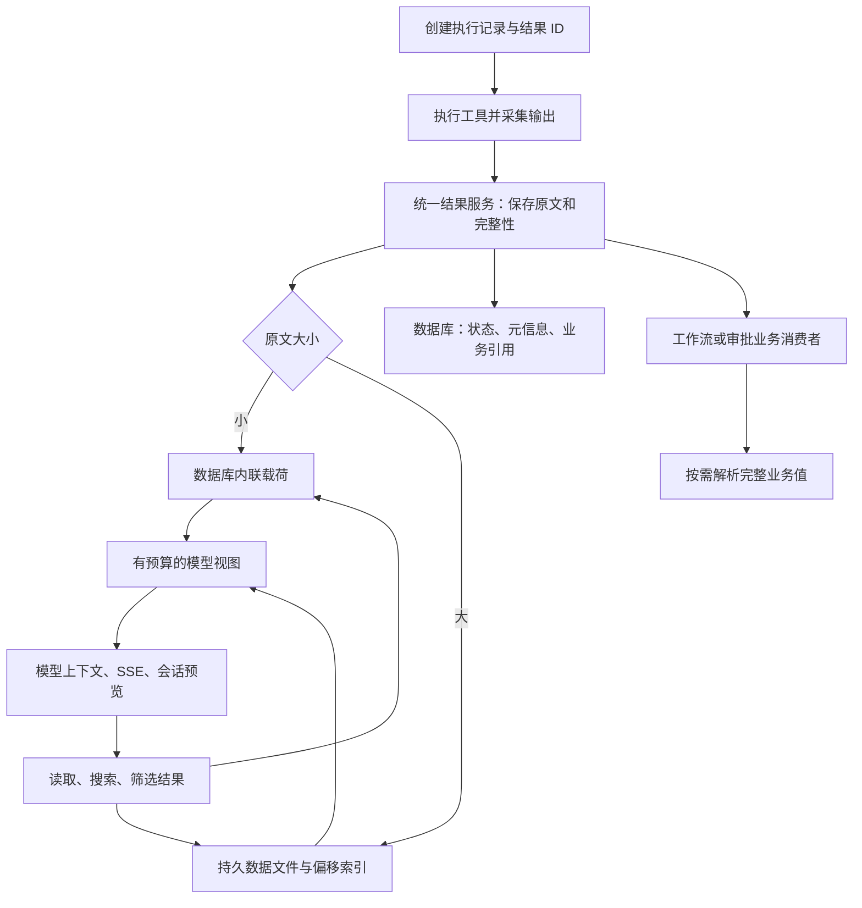
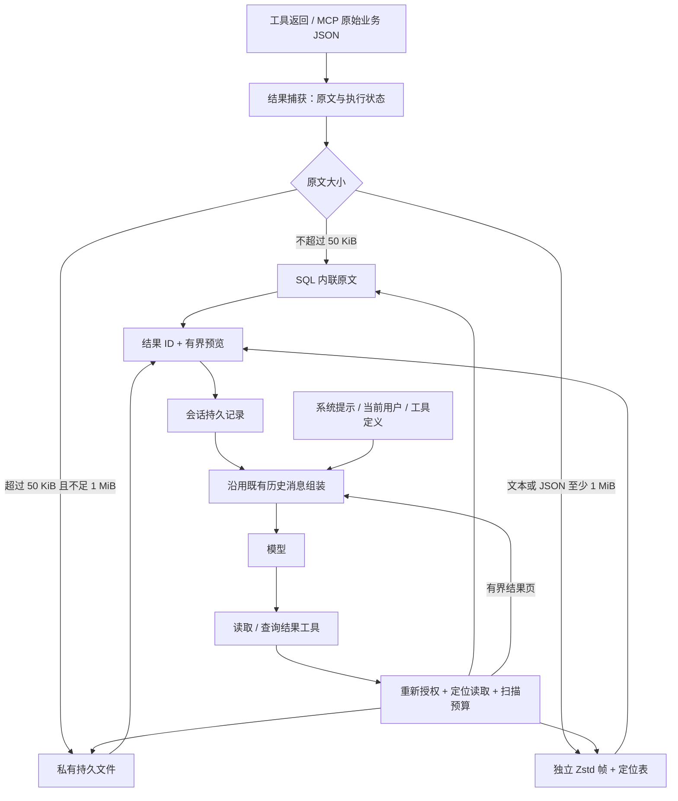
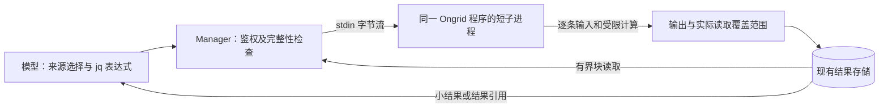

# Ongrid 工具结果压缩存储与按需读取方案

- 状态：首期核心代码已实现，新结果捕获始终开启；受影响路径的本地回归已通过，并已部署本机测试环境完成三组模拟对话验收。未发布到生产、未进行生产压测。
- 日期：2026-11-16。
- 关联：[Issue #590](https://github.com/ongridio/ongrid/issues/590)、[Issue #591](https://github.com/ongridio/ongrid/issues/591)。
- 核对基线：主分支 `5d22f5d75c31d5489e39251044fa7942501b52c1`。本地只读导出基于其父提交 `028d38c5`；已核对两者差异，新增提交仅修改 v2/v3 告警草案预算保护及测试，不改变本文引用的存储、MCP、Edge 和工作流实现。
- 交付范围：阶段 A/B 的单 Manager、v2/v3 聊天及聊天审批闭环。第 18 节区分已实现契约与后续目标；前文的全平台验收清单不代表均已通过。启用和回滚见 [运维说明](../install/tool-results.md)。

## 1. 设计结论

采用“原始结果、业务引用、模型视图”分离的方案：

1. 小结果保存在现有 MySQL / SQLite 中；大结果保存在持久文件中。多实例部署使用共享文件系统或对象存储。
2. 同一次执行的完整业务结果只保留一份权威副本。聊天、审批、工作流和报告引用同一个结果 ID；可以各自保存小预览。
3. 结果在首次有损转换之前保存。进入模型上下文的内容可以缩短，但必须携带可读取的结果 ID、完整性说明和读取方式。
4. 提供有预算的分页读取、关键词搜索、JSON 字段选择和简单筛选。模型不必逐页读完整份结果。
5. 保留安全容量上限。超限、采集不全、保存失败与“只缩短展示”是不同状态，不能混为一个 `truncated`。
6. 工具目录和执行结果采用不同策略：MCP Schema 完整存储；执行结果允许生成有明确标记的模型视图。
7. 首期纳入大文本结果的分块无损压缩；分页只解压命中块。压缩阈值与参数通过实测调整，不承诺固定压缩率。
8. 分块存储节省磁盘；有界预览、筛选和分析减少进入模型的结果数据。本次不新增模型请求的总上下文预算、历史裁剪或输出 token 上限，保留既有历史条数、执行轮数和每日额度限制。

首期按当前安装包 / Compose 的单 Manager 场景设计，直接使用持久目录，不要求用户增加 MinIO、Redis、搜索引擎或向量库。多 Manager 使用独立本地盘时，不能启用该部署模式。

## 2. 当前代码说明了哪些问题

下列结论来自代码检查，不是生产事故复现。

| 位置 | 已确认行为 | 设计影响 |
| --- | --- | --- |
| [审批模型](https://github.com/ongridio/ongrid/blob/5d22f5d75c31d5489e39251044fa7942501b52c1/internal/manager/model/approval/model.go#L55) | `approvals.result_json` 为 TEXT | #590 的直接容量瓶颈 |
| [审批执行](https://github.com/ongridio/ongrid/blob/5d22f5d75c31d5489e39251044fa7942501b52c1/internal/manager/biz/approval/usecase.go#L132) | 先执行工具，再保存结果；保存失败返回错误 | 执行状态和结果保存状态必须分开，不能因保存失败自动重跑 |
| [会话模型](https://github.com/ongridio/ongrid/blob/5d22f5d75c31d5489e39251044fa7942501b52c1/internal/manager/model/aiops/model.go#L180) | 工具结果和消息正文都存在 TEXT 字段 | 只改审批表会把问题转移到聊天表 |
| [工具持久化](https://github.com/ongridio/ongrid/blob/5d22f5d75c31d5489e39251044fa7942501b52c1/internal/manager/biz/aiops/runtime/v3/graph/callbacks/persistence.go#L794) | 同一结果写入工具调用记录和 role=tool 消息 | 原文去重；两处保留同一结果引用和小视图 |
| [MCP 模型](https://github.com/ongridio/ongrid/blob/5d22f5d75c31d5489e39251044fa7942501b52c1/internal/manager/model/mcp/model.go#L51) | 整个工具目录 JSON 保存到一个 TEXT 字段 | #591 单独扩容，不能截断执行 Schema |
| [MCP 客户端](https://github.com/ongridio/ongrid/blob/5d22f5d75c31d5489e39251044fa7942501b52c1/internal/pkg/mcpclient/client.go#L58) | 结果只建模 `content.type/text`、`isError`，随后拼成文本 | 需要在此之前保留完整业务载荷，包括 structuredContent 和资源信息 |
| [MCP HTTP 接收](https://github.com/ongridio/ongrid/blob/5d22f5d75c31d5489e39251044fa7942501b52c1/internal/pkg/mcpclient/client.go#L245) | 普通响应通过 8 MiB LimitReader 读取；SSE 使用 Scanner 上限 | 大响应可能在解析前被截短；需要明确的超限检测，SSE 应限制整个事件而非仅单行 |
| [Edge 命令策略](https://github.com/ongridio/ongrid/blob/5d22f5d75c31d5489e39251044fa7942501b52c1/internal/edgeagent/cmdpolicy/policy.go#L29) | 默认 stdout 64 KiB、stderr 16 KiB；超出部分被丢弃 | Manager 事后落盘无法恢复这些字节，需改采集端 |
| [Manager Shell Runner](https://github.com/ongridio/ongrid/blob/5d22f5d75c31d5489e39251044fa7942501b52c1/internal/pkg/runner/runner.go#L95) | stdout / stderr 各有默认 1 MiB 上限 | 保留内存预览上限，另加有容量限制的流式结果写入 |
| [工作流调用](https://github.com/ongridio/ongrid/blob/5d22f5d75c31d5489e39251044fa7942501b52c1/internal/manager/biz/flow/noderegistry.go#L278) | 下游节点直接使用工具完整 JSON；节点输入输出也写数据库 | 模型预览不能替换工作流业务值 |
| [私有附件存储](https://github.com/ongridio/ongrid/blob/5d22f5d75c31d5489e39251044fa7942501b52c1/internal/manager/data/aiops/store/attachment.go#L20) | 已有私有目录、临时文件、rename、归属检查及清理 | 复用这些做法；不复用其整文件 ReadFile 和图片专属数据模型 |
| [RCA 证据设计](https://github.com/ongridio/ongrid/blob/5d22f5d75c31d5489e39251044fa7942501b52c1/docs/rfc/RFC-010-rca-evidence-provenance.md) | 证据引用校验执行 ID、实际父子会话和用户归属；读取有界 | 新结果引用必须接入既有证据校验，不能绕开权限或丢失可追溯性 |

另外，图适配器会缩短长错误；调查输入、关联分析和追踪导出也存在有损视图。应逐项区分展示优化和原文采集，不能全局删除所有限制。

## 3. 核心语义与边界

### 3.1 “完整”必须有明确含义

本文的完整原文，是工具本次实际返回、经过既定安全处理的业务载荷，不是上游系统的全部数据，也不包含认证请求头。

- 一个工具只返回第一页，即使这页完全保存，也不能声称已获取全部数据。
- 工具主动做聚合、字段投影或采样时，记录该查询范围和转换；不强制复制数据库或日志源的全部原始数据。
- 上游已经截断的数据不能恢复。旧记录没有可靠标记时，完整性记为 unknown，不能补成 complete。
- 先保存已收到的完整结果，再生成摘要；摘要不是审计原文，不替代原文。
- 必须沿用已有敏感字段处理。脱敏后的载荷记录 `redacted` / 策略版本，校验和针对实际保存的字节。不能承诺识别任意文本中的所有秘密。

### 3.2 分开记录四类状态

| 维度 | 含义 | 示例 |
| --- | --- | --- |
| execution_status | 工具自身执行情况 | succeeded / failed / cancelled / unknown |
| capture_status | 本次响应是否完整采集 | complete / partial / unknown |
| storage_status | 已采集数据的持久化情况 | staging / ready / failed / expired / deleting |
| view_status | 本次给模型或 UI 的内容 | full / excerpt / summary |

另存 `source_has_more`（未知时为空）和 `capture_reason`。`ready + partial` 表示已收到的部分被可靠保存，不表示原文完整。`excerpt + complete + ready` 才表示“本次仅展示部分，原文可读取”。

工具超时仍可以保存已收到的 stdout/stderr；工具失败也可能有完整错误响应。保存层不把这些情况改写成工具成功或失败。

## 4. 目标链路



物理存储与模型视图分别限额。原文保存成功不代表可以全部放入上下文；上下文缩短也不应删除原文。

## 5. 存储设计

### 5.1 数据库负责什么

新增 `tool_results`，保存结果身份、状态、小载荷和存储定位。建议字段如下，最终 Go 类型与命名在实现时沿用仓库约定：

| 字段组 | 内容 |
| --- | --- |
| 身份 | `id`、服务端生成的 `execution_id`、来源工具、runtime_version、创建时间 |
| 所有权 | 来源类型与来源 ID、创建主体；不假定现有所有表都有 tenant_id |
| 状态 | 四类状态中的执行、采集、存储状态及原因；视图状态随响应生成 |
| 载荷 | `inline_body`、`backend`、内部 storage_key、content_type、format_version、storage_encoding（none / zstd_seekable） |
| 校验 | captured_bytes、stored_bytes、已知时的 expected_bytes、SHA-256 |
| 读取 | index_version、index_status、已知时的行数 / 记录数、source_has_more |
| 生命周期 | expires_at、updated_at、finalized_at |

`inline_body` 使用二进制字段存储字节，应用上限为 50 KiB（51,200 字节）。MySQL 与 SQLite 分别验证映射。大小按序列化后的 UTF-8 字节计算，不按字符数判断。

新增小表 `tool_result_refs`，把一个结果关联到 chat_tool_call、chat_message、approval、flow_run_node、operation 或报告证据。唯一键为 `(ref_kind, ref_id, slot)`；`result_id`、到期时间建立索引。它解决跨入口复用和清理问题，不授予读取权限。

列表接口批量读取该页引用与元信息，不逐条访问文件，不返回 inline_body。小结果和预览允许有少量重复；大原文不能同时复制到审批、消息、工具调用、工作流和追踪系统。

现有 `result_json`、role=tool 的 `content` 等保留用于兼容，写入大小受控的视图。是否存在有效结果引用以数据库关联为准，不能相信外部工具自己返回的 `result_id` 文本。

### 5.2 大结果文件

首期使用独立私有持久目录，例如 `/var/lib/ongrid/tool-results`。新增 Compose 挂载、安装/升级目录权限和备份说明；不能放容器可写层或临时目录。

逻辑布局：

```text
tool-results/<date>/<shard>/<result-id>/
  payload.data       # 完整业务载荷；none 或可定位的 Zstd 帧，编码由 manifest 指明
  manifest.json      # 格式、大小、校验和、采集状态、可恢复提交信息
  index.bin          # 可重建的偏移索引；按需存在
```

不是每条日志或每个 JSON 元素建一个文件。以每次工具结果为单位，通常只有 2–3 个文件；日期与散列前缀分散目录压力。storage_key 由服务端生成，用户和模型不能指定文件路径。

复用现有附件的私有目录、临时文件和原子 rename 做法，并补上所需 fsync / 文件关闭错误处理。图片附件与工具结果共用权限习惯，不共用图片专用的整文件加载流程。

### 5.3 多实例与对象存储

对外只暴露结果 ID，内部只需窄接口：写入、读取指定字节范围、删除。单机实现使用文件；共享实现可使用现有 S3 兼容对象存储，或部署明确提供的共享持久卷。

- 独立本地盘不能让请求随意漂移到其他 Manager。多副本上线必须先完成共享后端验收，不能依赖粘性会话掩盖故障转移问题。
- 对象存储写入成功、校验完成后才将 metadata 置为 ready。数据库不长期保存预签名 URL。
- 下载经过 Ongrid 鉴权；需要临时直链时，在读取时短期签发。
- 第一期无需引入一个全平台文件服务，也无需为了单机部署新建 MinIO 集群。

### 5.4 压缩与随机读取

完整版本应包含无损存储压缩，随阶段 B 的读写闭环交付。先前“首期不压缩”是减少初次实现复杂度的取舍，不是行业标准，也不表示压缩不适用。

区分三种机制：存储压缩减少磁盘或对象字节；传输压缩减少网络字节；上下文缩减通过筛选、预览和摘要减少模型输入。前两者无损，不能代替第三者，也不会自动降低解压后的 token 数。压缩后仍可能超出数据库字段容量，因此不能把 gzip + Base64 塞回 TEXT 作为根治方案。

建议起点如下；大小均按压缩前的已采集字节计算，阈值不是外部标准：

| 载荷 | 默认策略 |
| --- | --- |
| ≤50 KiB | 数据库内联，不压缩 |
| >50 KiB 且 <1 MiB | 持久文件，不压缩 |
| ≥1 MiB 的文本、日志、JSON | Zstd 独立帧；每帧约 1 MiB 未压缩字节，从低压缩级别开始压测 |
| JPEG、ZIP 等已压缩内容 | 保留原编码，默认不再次压缩；MCP 里的 Base64 由附件策略处理 |

优先采用公开的 [Zstandard Seekable Format](https://github.com/facebook/zstd/blob/dev/contrib/seekable_format/zstd_seekable_compression_format.md)：独立帧和文件尾部 seek table 放在同一个载荷文件或对象中。不要每块创建一个小对象。普通 `.zst` 文件不自动具备随机读取能力；须验证所选 Go 实现支持生成和读取该定位表。现有 go.mod 已包含 `github.com/klauspost/compress v1.18.5` 间接依赖，可复用 Zstd 编解码，但不能据此宣称 seekable 集成已经完成。

读取分两次定位：行号 / JSON 元素索引得到未压缩字节范围；seek table 再映射到压缩帧的物理偏移。文件 seek 或对象 Range 只读取命中的帧，再有界解压和截取页面。字段筛选和全文搜索仍可能扫描多个块，不能因分块压缩就声称无需扫描。

可靠性与兼容要求：

- manifest 记录编码、格式版本、压缩前后大小；整体 SHA-256 对保存的未压缩业务字节计算，使用帧校验发现局部损坏。结果 ID 和逻辑 cursor 不随物理编码改变。
- 写入采用有界帧缓冲，限制并发压缩任务。阈值判断最多缓冲到设定边界；不能为了压缩再次整份载入内存。
- 原文字节上限、解压输出上限、解码器内存与扫描时间限制继续生效。物理存储配额另算，不能只凭压缩后的体积接收任意大结果。
- 在 ready 前完成帧、定位表、manifest 的提交。压缩失败不能发布正常引用；仍有可靠原文时可按 none 提交，否则按既有保存失败流程处理，禁止重跑原工具。
- 老文件保持可读，不要求全库重压缩。读取侧必须先支持两种编码，才启用压缩写入；回滚基线也必须能读压缩结果。文件重编码要先验证新副本并原子切换，旧副本待在途读取结束后清理。
- 下载原文时由服务端流式解压；明确区分 API 的逻辑范围与对象后端的物理 Range，不能直接将两者等同，也不能把预签名压缩对象地址伪装成原始 JSON 下载。

不在此次增加自定义字典、长期整文件解压缓存或自动冷热迁移。压缩参数以真实 Jenkins / Grafana / 日志样本的容量、写入 CPU 和页读取延迟共同决定。

## 6. 写入与故障恢复

### 6.1 一次执行只生成一个权威结果

1. 执行前由服务端生成 execution_id / result_id，建立来源关联。写操作及审批先持久化执行意图并检查结果存储可用性和额度。
2. 支持流式输出的工具，使用有界缓冲写入临时载荷，同时统计大小、校验和、预览及偏移。stdout 与 stderr 的顺序分别保留，不伪造两者全局时间顺序。
3. 小结果可以在完成后通过一个数据库事务保存内联正文、引用和最终状态。大结果先提交载荷与 manifest，再通过数据库事务发布 ready 和来源引用。
4. 相同 execution_id 的落库重试复用同一结果。已完成内容不可变；相同 ID、不同校验和视为冲突，不能覆盖。
5. 给模型返回投影和结果 ID；审批等待方、聊天回调等沿用已有结果，不再次复制原文。

现有 BaseTool 返回 string 的接口先保留：非流式工具在返回后统一保存，内存使用仍然与其返回值有关。只有接入流式采集的路径，才能声称大结果不整份驻留内存。

MCP 等最早接触原文的适配器可通过调用作用域的内部采集句柄登记结果。该句柄按单次调用创建，不使用全局可变状态，也不从模型参数反序列化。外层看到已有登记结果时只绑定引用。

### 6.2 数据库和文件不能假装是同一事务

| 故障点 | 处理 |
| --- | --- |
| 工具开始前，额度不足或存储不可用 | 拒绝需要可靠归档的执行；提示可处理的容量错误 |
| 文件完成，数据库提交失败 | 保留已 fsync 的 manifest / 载荷，由协调任务重试发布元信息，禁止重新执行工具 |
| 数据库已有 staging，进程退出 | 协调任务检查完成标记；有完整载荷则补提交，否则标为不完整或执行未知 |
| 小结果数据库写入失败 | 可写入同一持久 spool 后重试发布；若 spool 也失败，明确告知保存失败 |
| 索引生成失败 | 原文仍可下载和按字节读取；索引状态 failed，不把工具执行改成失败 |
| 文件缺失或校验不匹配 | 返回 unavailable / corrupted，不能伪造空结果或拿另一次执行替代 |
| 工具已执行，但落盘和数据库均失败 | 保留能持久化的最小状态；不能保证恢复原文，更不能自动重跑非幂等操作 |

无法仅靠此存储方案保证外部副作用 exactly-once。进程可能在外部执行完成、记录结果之前退出。此时需沿用执行租约和幂等机制，标记 unknown；只有上游支持幂等键或结果查询，才允许有依据的恢复。

提交后的原始字节保持不可变。后续摘要、索引和字段视图是派生数据，失败可重建。

请求取消仍作用于工具执行和采集。对已经收到的结果，可以沿用现有持久化路径的独立短超时完成保存；不能继承已经取消的 context 立即丢弃结果，也不能改成无截止时间的后台写入。尚未收到的字节不能因保存收尾被标为已采集。

## 7. 在首次截断之前采集

### 7.1 MCP

- 在 `TextContent()` 和 string 化之前，保存完整的工具结果业务载荷。用 RawMessage 等方式保留未知字段，不能只保存当前简化结构再声称无损。
- 保留 `content`、`structuredContent`、资源引用、`isError`；多媒体内容使用受限附件或资源处理，不把大段 Base64 塞入模型上下文。
- 普通 HTTP 响应使用 `limit + 1` 明确检测超限；SSE 按重组后的单个 JSON-RPC 响应设置上限，并检查返回 ID。限制解压后字节，避免仅靠 Content-Length。
- 初始响应硬上限建议 16 MiB，属于需验证的配置起点。超过时保存可保留的响应前缀并标记 partial / transport_limit；如果协议已不完整，不以正常 JSON 提供查询。
- 超过协议硬上限的业务需求，优先让上游工具分页、导出为资源链接或按查询缩小范围。不能无限提高接收上限。
- 采集到完整响应，不意味着抓取了资源链接的目标文件；下载引用资源还需要现有网络策略、凭证边界与独立容量限制。

### 7.2 Shell、Edge、Skill

保留现有 stdout/stderr 内存预览限制，增加有界 spool 写入。命令输出应同时进入预览缓冲和持久采集器；预览满了停止增长，持久采集继续到单次上限。

Edge 侧通过受权限控制的文件/流接口分块上传，不能把大文件重新塞进当前隧道的单个 JSON 消息。复用现有隧道能力，但需要新增明确的结果传输契约、能力协商、块序号、校验和与恢复语义。

旧 Edge 没有新能力时，只能保存它实际返回的预览；必须标为 source_truncated，不能显示“完整结果已保存”。Edge 到 Manager 上传未完成时，仅有 Edge 本地文件不等于 Manager 已可靠归档，不能提前删除唯一副本。

达到硬上限后，停止保存新增字节并标记 partial；命令执行时限和输出采集限额独立。对已经在执行的写命令，不因预览或归档限额直接自动重跑或假设操作回滚。避免输出管道阻塞，并在结果中说明保存范围和已丢弃字节数（可确定时）。

### 7.3 业务查询工具

日志、Trace、Kubernetes 等工具继续优先使用上游分页、字段选择和聚合。源头可按页查，就不为了“完整”自动查询所有历史数据。

查询范围、原工具 cursor 和结果存储 cursor 分开：前者可能请求更多上游数据，后者只读取已保存的不可变快照。读取结果工具绝不能悄悄重新执行原工具。

## 8. 高效读取

### 8.1 首期提供两个只读工具

| 工具 | 输入 | 返回 |
| --- | --- | --- |
| `read_tool_result` | result_id、part、读取模式、cursor、limit；JSON 可带 collection_pointer 和 fields | 有界数据页、实际范围、next_cursor、完整性与视图状态 |
| `query_tool_result` | result_id、关键词或受限字段过滤、fields、可选 count、cursor、limit | 命中片段 / 记录、来源位置、扫描进度、next_cursor、统计是否完成 |

元信息随首次工具预览返回；UI 另有元信息接口。工具参数使用互斥模式，避免把文本偏移、数组偏移和过滤 cursor 混用。

这两个读取工具返回的是既有结果的视图，不再次归档成新的完整结果。它们只记录读取动作、来源范围和受控返回页，避免“读取结果又生成结果”的递归存储与上下文膨胀。

第一版查询只支持字面关键词、JSON Pointer、明确的比较操作和字段选择。统计先提供 count；不执行用户传入的 SQL、JavaScript、shell 或任意 jq 表达式。这一读取接口保持有界；完整数据的复杂计算通过第 18.7 节的可选隔离代码执行完成，不向查询接口叠加通用表达式解析器。

### 8.2 文本、JSON 和大字段分别处理

- **文本/日志**：以字节偏移继续读取，按换行边界返回有界片段；超长单行明确标为片段。UTF-8 边界安全；默认 Scanner 的单行限制不能成为隐蔽截断点。
- **JSON 数组 / 已识别集合**：流式建立元素偏移索引，按元素分页；选择 `name/status/url` 等字段后再构造响应。保留原始数字表示，避免 ID 经 float64 转换丢精度。
- **任意复杂 JSON**：首期只对受限体积做一次受控解析；大对象优先生成已支持集合的索引。索引未就绪时提供原文片段读取，明确 structured_query_unavailable，不能每次请求都整份反序列化。
- **单个超大字符串或记录**：返回字段摘要、原始范围和继续读取方式；不把半截 JSON 标为有效业务对象。
- **图片/二进制**：元信息和下载/专用处理入口，不做全文文本扫描。

首期可以把索引作为一个小 sidecar 保存：文本每约 256 行或 64 KiB 一个定位点，JSON 集合保存元素偏移。载荷不因建立索引被复制为另一份完整 JSONL。

JSON 索引只覆盖明确支持的集合路径。索引解析同样有深度、记录大小、CPU 和内存限额；异常或不支持的输入始终可以回退为原文读取。

### 8.3 Cursor 与扫描边界

cursor 绑定 result_id、内容版本、part、查询指纹、偏移和有效期，并签名或由服务端保存。下一页仍重新鉴权。更改筛选条件必须开始新查询，不能复用旧 cursor。

读取页限制记录数和序列化字节。任一上限先达到就结束本页并给出准确的继续位置。整条记录放不下时返回可定位的字段片段，不能反复返回同一个超大记录而永不前进。

关键词查询没有全文索引时就是有界顺序扫描，复杂度为 O(扫描字节数)，不能宣称 O(1)。达到时间或扫描字节预算就返回扫描 cursor。未扫完时：

- `scan_complete=false`；
- count 仅表示已扫描范围，`count_exact=false`；
- 没有命中不等于整个结果没有匹配内容。

首期复用操作系统页缓存，不引入额外 Redis。若热点重复查询成为实测瓶颈，再增加按结果版本、查询条件和授权范围区分的有界缓存。

### 8.4 模型看到的返回值

示例数据仅说明协议：

```json
{
  "result_id": "server-generated-id",
  "execution_status": "succeeded",
  "capture_status": "complete",
  "storage_status": "ready",
  "source_has_more": false,
  "view_status": "excerpt",
  "captured_bytes": 12582912,
  "format": "json",
  "record_count": 12000,
  "preview": {"items": [{"name": "payments", "status": "failed"}]},
  "preview_selection": "first_records",
  "available_actions": ["read_tool_result", "query_tool_result"]
}
```

这表示“本次响应已完整保存，当前只是开头样本”，不表示样本覆盖所有业务状态。模型应优先搜索/筛选；只有用户要求完整导出才走下载，不通过连续翻页把全部原文重新塞入上下文。

默认预览由确定性程序产生：大小、记录数、字段名、少量首尾内容及已知错误。LLM 摘要只作为可选派生视图，不放在可靠保存的必经路径，也不能覆盖原文。

## 9. 初始容量预算

以下是待压测的首发建议值，不是行业标准或已验证的性能结论。优先内部常量加少数运维配置，不为每个细节新增后台选项。

| 项目 | 建议起点 | 作用 |
| --- | --- | --- |
| 数据库内联原文 | ≤50 KiB | 小结果少一次文件读取 |
| 首次模型视图 / 读取页 | 首期最多 4,000 个序列化 UTF-8 字节 | 防止中文、转义或元信息放大载荷 |
| 一页记录数 | 默认 50，上限 200；仍服从字节上限 | 避免超长单页 |
| 单个结果保存上限 | 默认 64 MiB 未压缩业务载荷 | 约束磁盘、内存及异常工具 |
| MCP 单响应接收上限 | 默认 16 MiB 解压后响应 | 与整体结果保存上限分开 |
| 每次查询扫描 | 最多 8 MiB 或 2 秒 | 未扫描完返回 cursor，不产生错误的完整统计 |
| 一轮结果读取预算 | 默认 24 次、64 MiB 扫描量、累计 32,000 返回字节，取先达到者 | 与原业务工具调用次数分开，仍受全局运行预算限制 |
| 大结果写入并发 | 首期本地文件发布串行；MCP 调用并发 2 | 限制复制和解析内存；需依据 RSS 验证 |
| 普通结果保留时间 | 默认 30 天；聊天审批引用 90 天 | 过期读返回不可用；引用保留另见下节 |

这些上限控制单个工具视图和读取操作，不是整次模型请求的 token 预算。连续工具调用仍可能累计到提供商的上下文上限。后续总结若无法确认完整性，应说明缺口。

## 10. 业务兼容：不能把所有结果一律换成预览

### 10.1 聊天与 v2/v3

共享结果服务负责保存和读取，v2/v3 各自在适配边界调用，不互相 import。现役版本同步覆盖存储缺陷；v1 归档代码不重新启用。

`BaseTool.InvokableRun` 初期保留 string 返回接口。图适配器先按原始输出计算执行状态、草案有效性和调用预算，再生成模型视图。持久化回调接收结果引用和受控视图。每次实际执行的原文只登记一次；memo 保存引用和小视图，不反复复制多 MiB 字符串。

现有特殊结果必须逐项适配：`config_draft`、`draft_hash`、审批卡片、operation ID、退出码等是业务控制数据。它们保留可信结构，确认与执行路径按结果引用解析完整原值，不从模型摘要中恢复参数。尤其要回归 #592 的预算结束与草案确认路径。

### 10.2 审批

审批记录保存执行状态、引用和小预览；聊天等待审批返回时沿用该引用。执行成功而归档失败时，前端应显示两个事实，不把所有状态折叠为“工具失败”。

复用已有执行租约和 owner 校验；结果协调只重试存储提交，不重试审批所代表的外部操作。审批执行的 runtime_version 不因系统默认版本切换而改变。

### 10.3 工作流与后台任务

工作流表达式和下游工具需要业务数据，不能接收模型摘要作为原结果。持久化 `OutputJSON` 保存小视图及内部引用，恢复、节点详情与表达式求值需要配套 resolver。

首期兼容已有有界的内存 JSON 传递，在持久化和模型入口完成分离；这不解决所有工作流内存峰值。随后把大值表示为内部句柄：访问特定路径时读取所需字段；必须整体物化时检查大小预算并给出明确错误。普通小值的表达式行为不变。

工作流节点的 InputJSON 也可能因前一节点的大结果展开而溢出，应记录输入来源引用和受控预览。实际执行参数仍完整、校验通过，不能截断参数后继续执行。

后台调查和外部 MCP 暴露的机器接口同样区分机器数据与模型视图；为既有机器接口增加资源引用时，需要明确契约，不能悄悄改变返回 JSON 形状。

### 10.4 RCA、UI、SSE 与追踪

- RCA 从已验证的执行记录解析 result_id 和范围，继续校验实际父子会话与归属。保留报告生成时的内容版本和范围，不读取后续执行替代旧证据。
- 已有 RFC-010 对系统会话和用户会话的访问限制保持有效。报告中的引用可延长保留时间，不能扩大原文访问权限。
- 会话列表、SSE 和 IM 消息只传元信息与小预览。展开“查看结果”时分页获取；提供搜索与下载。页面明确区分“已保存全文”“采集不完整”“已过期”。
- OpenTelemetry 不承载完整大结果；继续使用现有脱敏与 8 KiB 内容预算，关联 result_id。不能为了追踪绕过结果权限。
- 图/审计回调的 best-effort 日志不能成为原文唯一保存点；原文捕获属于执行结果处理，而非可丢弃的追踪附属数据。

## 11. #591：MCP 工具目录单独处理

保留 `mcp_servers.tools_cache_json` 的现有结构，改为能容纳目录的 LONGTEXT，并设置应用级总目录字节上限。首期总目录上限为 16 MiB；实际须同时满足数据库包大小和部署资源预算。

现有客户端已经支持 tools/list 分页、循环 cursor 检查和条数限制。新增所有页合并后的字节预算，不再重复实现另一套分页机制。

- 目录刷新成功后原子替换；超限或获取失败保留上一次有效目录。
- 保存完整 Schema 与实际执行契约；继续复用 ToolSearch、ExecutionParameters 与模型侧按需展示能力。
- revision 计算继续基于完整目录；不能用截断 Schema 或摘要冒充原目录，导致审批针对的工具契约发生变化。
- LONGTEXT 不解决 `max_allowed_packet`。启动检查或错误提示应区分字段容量、包限制、目录总量超限。
- 当前不把工具目录放入 30 天清理的结果存储，也不为 #591 新建对象存储依赖。

## 12. 权限、生命周期与备份

### 12.1 权限

结果 ID 是定位符，不是访问凭证。每次读取、查询、下载均检查当前用户、来源对象权限和有效关联；复用 auth / tenantctx / 现有会话、审批与工作流校验。当前 tenantctx 是身份上下文，不能假定已存在统一租户隔离列。

引用绑定只由服务端完成。子任务读取父任务结果必须通过真实的授权关系，不能只比较客户端传来的 root_session_id。缓存不能让不同主体共享未经重新鉴权的响应。

原文视为不可信数据，UI 按文本转义，模型读取时仍是工具数据。禁止以任意 path 或 URL 形式开放本机文件读取；下载名和 HTTP 响应类型不得执行返回内容。

### 12.2 清理

- 普通结果默认 30 天；正在运行的工作流、未完成审批、有效报告证据引用可保留到其业务生命周期结束。
- 延长保留不等于无限制增长：受整体磁盘水位和配额约束。接近容量上限时拒绝新的必需归档任务并告警，不能静默删除仍有效的证据。
- 先在数据库将结果置为 deleting，使新读取失败，再删除正文与索引，最后保留轻量 tombstone。删除可重试，兼容 MySQL / SQLite，不依赖单一数据库的锁语法。
- 增加引用和进入 deleting 必须在事务中争用同一结果的状态/版本：只有 ready 结果能增加引用，清理必须在确认无有效引用后条件更新。不能先无锁查引用、随后直接删文件。
- 普通来源删除解除其引用；仍有合法保留引用的结果继续存在。明确删除敏感原文的操作使所有引用失效，不留下可继续下载的 URL。
- 无有效引用的孤儿载荷经过宽限期清理，协调任务先判断 staging 是否仍有执行/写入租约。不能按文件 mtime 直接删除在写文件。
- 读取与删除要协调：已开始的流式读取可持有短租约；禁止新读取后再完成清理，不把删除过程中的短读伪装成完整正文。

### 12.3 备份

数据库和结果目录/对象存储共同组成可恢复状态。备份先固定数据库引用快照或短暂停写，保护所引用的不可变载荷，完成校验后才解除 GC 保护。仅备份数据库不能宣称聊天原始结果可恢复。

## 13. 模块落点与调用方范围

新增一个面向业务的 `internal/manager/biz/toolresult`，负责捕获登记、引用、授权协调、预览和读取用例。Repo 与字节存储接口在消费方定义，具体实现放 `internal/manager/data/toolresult`；持久实体放 `internal/manager/model/toolresult`。IO 基础能力若提取到 internal/pkg，不能依赖 manager。

不建立新的 Agent Runtime，也不把结果查询改成独立微服务。

| 范围 | 需要接入或检查的位置 |
| --- | --- |
| 装配与 schema | cmd/ongrid/bootstrap_storage.go、bootstrap_aiops/runtime、模块 Migrate |
| 最早采集 | internal/pkg/mcpclient、biz/mcp、internal/pkg/runner、Edge cmdpolicy 与 tunnel 结果契约 |
| 共用执行入口 | tools/basetool、decorators 的审计边界、v2/v3 graph/tool_adapter、MCP trusted/approval 两条路径 |
| 持久化与回放 | v2/v3 graph/callbacks/persistence、data/aiops/store/session、历史组装、memo、SSE |
| 审批与控制结果 | biz/approval、service/aiops/approval_executors/adapters、config_confirm、alert_draft_guard、budget_stop_model |
| 工作流与后台 | service/flow/tools、biz/flow/engine/noderegistry、表达式/历史恢复、background_tools、operations |
| 证据与审计 | investigation_evidence reader、报告证据 resolver、追踪内容关联 |
| API 与前端 | 对应 proto/DTO、私有结果读取接口、会话/审批/工作流详情、UI 按需加载和下载 |
| 安装与运行 | 两套 Compose、安装/升级权限脚本、数据目录备份/清理说明、CODEOWNERS |
| 测试与夹具 | MySQL/SQLite、大结果 MCP、Edge 新旧版本、并发、故障、草案确认、工作流引用、RCA 越权 |

大结果来源不限于输出：arguments、审批 payload、工作流输入同样存在 TEXT。首期检查所有写入边界，禁止无限输入；确有合法大参数需求时使用明确的输入资源引用，不能截断参数。不要借本次方案把全部表无差别改成 LONGTEXT。

## 14. 迁移和上线顺序

遵守当前仓库规则：通过 GORM AutoMigrate、各模块 Migrate 和 dbx.RunMigrations 管理，不新增独立 SQL migration 框架。

### 阶段 A：兼容准备与容量止血

1. 对已知结果写入字段做针对性扩容和边界处理：审批结果、聊天工具结果、role=tool 正文、工作流节点结果；工具目录单独 LONGTEXT。
2. 引入可空的新元信息 / 关联表，读取侧同时支持旧内联结果和新引用，旧记录不做“完整性已验证”的回填。
3. 新读取接口和 UI 先具备理解引用的能力；此时尚不启用外置结果写入。
4. 明确检查 MySQL 包限制、重复启动迁移与 SQLite 兼容。

旧版本可能仍按 TEXT 模型执行 AutoMigrate，因此不能承诺任意旧版重启或滚动混跑安全。首次升级需阻止旧进程重新迁移，按部署采用维护窗口或分步替换。兼容基线完成后，才逐步启用新写入。

### 阶段 B：闭环上线

同时交付持久目录、结果服务、捕获入口、引用读取、模型视图、两个只读工具、审批状态处理和清理；大文本压缩与压缩分页读取一同验收。可以先对 MCP 灰度，但不能上线“存成文件却没有读取工具”的半成品。

灰度按端到端调用路径启用，例如先启用“聊天 MCP + 审批”。工作流或外部机器接口的 resolver / 契约尚未就绪时，不能因为它们共用 MCP 底层就同步切换返回形状；继续使用阶段 A 的有界兼容路径。

现有旧数据按需读取，不全库搬迁。对超过视图预算的历史正文可在访问时幂等转存；元信息标记 legacy / unknown，不声称恢复了历史截断。

### 阶段 C：采集源与机器消费者收尾

接入 Edge / Shell 流式采集、工作流引用解析、RCA 和控制结果兼容。此阶段完成前，产品文案必须限定已覆盖来源，不能声称任何工具都不会丢失大结果。

### 阶段 D：按实测扩展

共享对象存储用于多实例上线；压缩阈值、帧大小与并发按实测调优。保持同一结果 ID 与读取 API，不影响上层业务。

### 回滚

回滚目标是已支持引用读取的兼容基线，而非任意老版本。关闭新外置写入后继续读取已保存结果；保留新表、大字段与载荷。禁止自动将 LONGTEXT 缩回 TEXT 或删除结果目录。

必须回到不识别引用的旧版本时，需要单独的数据降级方案；超过其容量上限的结果无法无损内联，此类回退不在普通一键回滚保证内。

## 15. 实施拆分与验收

建议拆成下列可独立评审的任务；估算不含现场环境等待，开始/完成日期待排期。

| 任务 | 内容 | 估算 |
| --- | --- | --- |
| 1 | 字段迁移、包限制诊断、双读契约和老数据回归 | 1–2 人日 |
| 2 | 结果表、引用表、持久文件后端、分块压缩、发布与故障协调 | 原估 2–3 人日；新增格式集成后重估 |
| 3 | 文本/JSON 偏移读取、压缩帧定位、受限搜索筛选、两个工具 | 原估 2–3 人日；新增格式集成后重估 |
| 4 | MCP trusted/审批、v2/v3 适配与 SSE | 2–3 人日 |
| 5 | 工作流、控制结果与 RCA 引用兼容 | 2–3 人日 |
| 6 | Edge / Shell 采集与传输、新旧协议回归 | 2–3 人日 |
| 7 | UI 按需展示、安装升级、清理备份、故障和容量验收 | 2–3 人日 |

共享对象后端单列后续任务；压缩格式属于完整版本的任务 2 / 3。未通过对应验收前，不宣称多实例共享存储或压缩读取已可用。

### 正确性与故障验收

- 64 KiB 边界前后、1 MiB、12 MiB MCP 响应能按策略保存，审批和聊天不再报字段溢出；原文校验一致。
- UTF-8 中文、JSON 转义、巨大单行、巨大字符串、超深对象、非法 JSON、structuredContent、多内容块和失败结果均有明确行为。
- 原文完整但预览省略、源头分页、旧 Edge 截断、传输超限、保存失败、过期六类状态不能互相混淆。
- 分页无重复、无跳项、cursor 必须前进；筛选/统计未完成时不能报告完整总数；按字段读取保留数字精度。
- 存储和读取重试不得重新执行工具；同一执行不会写出多份不同的权威结果。
- 注入磁盘满、数据库断开、上传失败、提交间崩溃、丢失文件、坏索引、清理竞态，验证恢复和真实状态展示。
- 同时运行工具执行、读取、清理；运行受影响包 race 检查。
- MySQL/SQLite 全新启动、旧 TEXT 升级、重复启动、部分迁移失败重启、兼容版回滚都通过；人工扩容后的重启不会被错误缩列。
- v2/v3、trusted/approval、会话恢复、tool_call 配对、#592 草案确认、工作流原 JSON 语义、RCA 证据快照都通过。
- 不同用户、伪造 result_id / cursor、父子会话伪造、系统会话、报告引用、删除后访问均不能越权。
- 安装包升级和容器重建后仍可读；数据库与载荷联合备份可恢复。多副本验收单独执行，不能用单机结果代替。
- none / zstd_seekable 双读、跨帧分页、超大单行跨帧、坏帧、坏定位表、解压额度、压缩失败、压缩结果回滚读取均有用例；解压后 SHA-256 与原文一致。

### 性能验收方法

性能目标是待测约束，不能把以下描述当作已取得数据：

1. 以相同正文比较 64 KiB、1 MiB、12 MiB、64 MiB 结果，记录写入耗时、数据库新增字节、文件字节和 Manager / Edge 峰值 RSS。
2. 测试读取第 1 页、中间页、末页；确认页读取的实际 IO 与命中块有关，没有每次全文件读取。索引首次构建单独计时。
3. 词搜索命中在尾部、无命中、JSON 大集合筛选分别测试；记录扫描量和 cursor 续扫，避免把返回页很小等同于查询成本很小。
4. 并发 1 / 4 / 16 调用测试背压；老 string 接口与流式接口分开报告，不能声称两者都恒定内存。
5. 首期本地索引页读取可把热读 P95 <100 ms 作为优化目标；实际硬件、文件大小、并发、冷/热缓存必须随结果一起报告。对象存储单独设目标。
6. 对同一任务比较模型实际输入 tokens、完成率、读取次数和证据遗漏；仅减少 tokens 不足以证明方案更好。
7. 使用真实代表样本及低可压缩样本，对比 none 与不同 Zstd 参数，记录压缩后/原始字节比、写入 CPU、吞吐、峰值内存、冷/热页读取 P95；报告索引开销。跨页读取只解压命中帧，搜索扫描成本另报。

可观测性至少覆盖原文/预览字节、压缩前后字节、压缩/解压耗时与失败、外置比例、采集不完整原因、保存失败、待协调数量、读取/扫描耗时、过期和磁盘水位。指标标签使用来源类型与原因枚举，不使用 result_id、session_id 或任意工具 URL；具体身份只进入受控结构化日志。

## 16. 备选方案与未引入的能力

| 方案 | 优点 | 问题 / 取舍 |
| --- | --- | --- |
| 所有结果继续进 LONGTEXT | 改动少，事务简单，适合作为容量止血 | 不能解决模型上下文、重复原文、整段传输和数据库增长 |
| 所有结果都建文件 | 一个存储路径，原文容易导出 | 小结果额外 IO 与小文件太多；采用大小分流更合适 |
| 数据库分块 BLOB | 单存储系统，备份与权限相对集中 | 数据库仍承担日志类大载荷与清理；目前不作为默认方案 |
| 数据库小结果 + 大结果持久文件/对象 | 适合现有单机部署，也可扩展共享后端 | 需要处理跨存储提交、授权、清理和备份，本文采用 |
| 仅保留摘要或首尾截断 | 容量最小 | 丢失可验证证据，无法解决用户当前问题 |
| 全部写搜索引擎或向量库 | 适合长期全文/语义检索 | 增加依赖、同步和成本，不能代替原文；当前不引入 |

暂不引入全量跨会话搜索、任意代码查询、跨用户内容去重、自动 LLM 摘要流水线或新文件微服务。将来有实测需求再扩展，不影响本次存储和读取闭环。

## 17. 公开方案参考

### 不同 MCP 的大结果如何进入模型上下文

MCP 定义工具响应可以携带的内容。服务可以提供结构化结果、文本、资源或链接，也可以声明输出 schema。标准游标分页适用于工具目录、资源目录等列表操作。单个业务工具返回的记录字段、分页参数和总数由该工具定义。Ongrid 的 `result_id`、行筛选和完整性检查属于客户端能力。[工具结果规范](https://modelcontextprotocol.io/specification/2026-07-28/server/tools#tool-result) · [分页适用范围](https://modelcontextprotocol.io/specification/2026-07-28/server/utilities/pagination#operations-supporting-pagination)

Claude Code 将超过阈值的成功非图片结果保存到会话文件，给模型路径供后续读取。Codex 的公开实现对写入模型历史的 MCP 结果施加输出预算，Code Mode 可处理原始结果。Anthropic 的工程示例进一步展示了在执行环境过滤一万行数据后，只返回计数和少量样本的做法。[Claude Code 文档](https://code.claude.com/docs/en/mcp#mcp-output-limits-and-warnings) · [Codex 的 MCP 输出实现](https://github.com/openai/codex/blob/afe555b9d3e95b4f58b247212565070f1555bc5d/codex-rs/core/src/tools/context.rs#L216-L282) · [Anthropic 的筛选示例](https://www.anthropic.com/engineering/code-execution-with-mcp)

Ongrid 复用会话内的结果引用。模型看到有界预览后，可在同一份保存结果上查看字段、定位文本、筛选行或执行流式计算。一个明确的记录数组可直接查询。发现多个候选时返回路径，请模型依据任务选择。收据、查询、跨页收集和 HTML 导出共用行发现规则。模型选择“哪些字段表达用户条件”，Manager 执行筛选并返回计数。查询只覆盖一页或源数据已截断时，需要在回答里说明范围。[调用示例与容量边界](../install/tool-results.md#finding-data-in-an-unfamiliar-result)

### 其他存储与上下文处理参考

- [Codex 历史处理](https://github.com/openai/codex/blob/main/codex-rs/core/src/context_manager/history.rs#L628)：保留记录与模型历史投影分离。
- [Codex 冷会话压缩](https://github.com/openai/codex/blob/main/codex-rs/rollout/src/compression.rs)：当前公开实现可将冷 JSONL 记录压为 `.jsonl.zst`；续写前物化为 JSONL。[功能定义](https://github.com/openai/codex/blob/main/codex-rs/features/src/lib.rs#L1480)将 `local_thread_store_compression` 标为开发中且默认关闭。它不是所有工具结果默认分块压缩的证据。
- [Codex 请求体压缩](https://github.com/openai/codex/blob/main/codex-rs/http-client/src/request.rs)：支持 Zstd 网络请求编码，与本地结果存储是不同路径。
- [Zstandard Seekable Format](https://github.com/facebook/zstd/blob/dev/contrib/seekable_format/zstd_seekable_compression_format.md)：独立压缩帧与定位表，可只解压子范围；不是普通 gzip / zstd 流自动提供的能力。
- [DeepSeek 自定义工具调用](https://api-docs.deepseek.com/guides/tool_calls/)由接入方执行工具并回传结果，未说明本地工具结果的压缩存储策略；Claude Code MCP 文档也没有声明文本结果文件的 gzip / Zstd 编码。不能据此断言各家云端使用或不使用压缩。
- [Anthropic：通过代码处理 MCP 大结果](https://www.anthropic.com/engineering/code-execution-with-mcp)：在执行环境中筛选和聚合，避免把全部数据送入上下文。
- [Claim Check 模式](https://learn.microsoft.com/en-us/azure/architecture/patterns/claim-check)：主记录保存引用，外部存储保存大载荷，同时处理发布一致性与生命周期。

以上参考支持架构方向，不构成各家云端内部存储实现的证据。本文所有阈值、数据模型和实施分期均为针对 Ongrid 的设计建议。


## 18. 首期统一契约与实现边界

### 18.1 从保存到模型请求



存储层保存校验和、状态、归属、期限及索引。超过 1 MiB 的文本/JSON 采用 1 MiB 独立 Zstd 帧和标准 seek table；范围读取只解压对应帧。超过 64 MiB 的载荷只保存允许的部分，并标为 partial。MCP 接收上限为 16 MiB，先保留完整 CallToolResult JSON，再做文本拼接，因此图片块、structuredContent 和未知字段不会因拼接丢失。上游在到达 Manager 之前丢失的字节不在完整性保证内。

普通工具视图和读取页最多 4,000 个序列化 UTF-8 字节。小返回值保留原有形状；草案控制结果保留完整协议。压缩载荷不直接发送给模型，解压也不减少 tokens。模型应优先按条件查询和聚合，避免连续翻页积累上下文；持久聊天历史保留各次读取记录。

### 18.2 模型请求边界

本次不新增总上下文估算、历史裁剪、图片 token 估算或输出额度配置。v2/v3 继续使用既有的历史消息条数、执行轮数和每日 token 限额。图片仍通过原有的上传校验与模型适配路径传递。

有界工具预览和分析可以减少单次结果大小，但不能保证连续工具调用始终处于模型容量内；实际容量由提供商限制。

### 18.3 读取与权限

模型工具为 `read_tool_result`、`query_tool_result`；HTTP 入口为 `/v1/chat/sessions/{id}/tool-results/{resultID}` 下的 metadata、read、query、download。所有读取重新检查调用者的会话权限以及结果所属会话树；父子关系从数据库验证。同一用户的无关会话、无关系统会话不能相互读取。

Cursor 使用签名，绑定结果 ID、内容校验和、查询参数、继续位置与一小时有效期；签名不替代授权。JWT 密钥变更后旧 cursor 失效，可以从第一页重新读取。JSON 页以 `data_json` 字符串传递原 JSON，等值过滤用 `equals_json` 字符串传递 JSON 字面量，避免浏览器或 Protobuf 把大整数转换为浮点数。

支持 bytes / lines / json 三种模式。首期 lines 按字节偏移读取换行块，尚无“跳到第 N 行”参数。原生 JSON 数组支持分页、JSON Pointer 字段选择、文本包含、精确等值和已扫描区间计数。`count_exact` 只描述本次 `scan_start..scan_end`；只有从头扫完才能视为全集计数。JSON 索引深度最多 4，集合最多 128，数组记录索引最多 100,000；大于 1 MiB 的单记录返回有位置的片段。MCP `content.text` 内嵌 JSON 暂按文本处理，原生 structuredContent 的数组可索引。

查询最多扫描 8 MiB 或两秒。每轮共享上限为 24 次读取、64 MiB 扫描及 32,000 返回字节；达到任一限制停止补充证据。读取工具本身不会再次归档为新结果。

### 18.4 持久性和运行边界

大结果先写私有临时目录，完成 fsync、manifest 和原子发布，再提交 SQL 元信息。数据库暂不可用时保留磁盘副本，标记 pending；恢复只发布已经保存的结果，不执行原工具。聊天审批使用审批 ID 幂等关联，并在恢复事务中修复审批状态。普通图执行使用每次执行 ID，不提供跨进程 exactly-once 外部操作保证。

保存失败与工具执行失败分别记录。写类工具在执行前检查数据库、目录及剩余容量，但这是提前检查，不是磁盘预留；执行后仍可能因并发或硬件故障无法保存，返回状态不得诱导重跑。

目录配额默认 10 GiB，可用 `ONGRID_TOOL_RESULTS_MAX_BYTES` 调整（最少 128 MiB）。配额统计目录内文件字节，不含 SQL 内联数据和文件系统块开销。单 Manager 串行发布文件，MCP 调用并发为 2。旧 string 返回接口和 JSON 索引构建仍会持有有界完整结果，不能宣称端到端恒定内存。恢复每轮最多新登记 100 个结果，后台每五分钟运行，单次维护有 30 秒时限；当前扫描目录，规模扩大前需改为待恢复队列。

新结果捕获、恢复与清理始终开启，不提供配置开关。Linux Manager 同时启用分析工具；结果读取继续执行授权校验。普通结果 30 天、聊天审批引用 90 天；过期后即便清理尚未执行也不可读取。RCA/报告的引用尚未接入；当前不提供额外的引用追加接口。

### 18.5 已覆盖与后续工作

| 范围 | 首期状态 |
| --- | --- |
| 结果表、私有文件、Zstd 随机读取、恢复、过期和容量上限 | 已实现；SQLite 和本地故障注入验证 |
| v2/v3 根会话、worker、MCP、聊天审批 | 已接入；已有审批/草案流程继续回归 |
| 只读检索工具、HTTP/UI 预览搜索下载 | 已实现；按会话权限读取 |
| 受影响 TEXT 字段及 MCP 工具目录 | 改为 LONGTEXT；使用现有 AutoMigrate |
| Edge/Shell 的源头流式采集 | 后续阶段；不能恢复原有采集截断 |
| 工作流全量结果引用解析、RCA/报告自动引用、旧历史批量转存、v1 | 后续阶段；保留原业务返回契约 |
| 多 Manager 共享存储、对象存储后端 | 未实现；当前只支持单 Manager 管理目录 |
| 专门的压缩/扫描时延 Prometheus 指标及真实容量压测 | 未完成；当前使用结果元信息和错误日志 |
| 生产 MySQL 迁移、大表锁表、物理断电、联合备份恢复及真实提供商验收 | 待上线前验证；本地测试不能替代 |

完整目标仍按第 14–15 节分期验收。启用前必须核对持久卷和模型容量；本次不自动修改生产配置。


### 18.6 本地验证记录（2026-11-16）

- 受影响包 `go test -race` 通过：resultfile、toolresult 存储/业务、approval、mcp、llm、v2/v3 graph/callback/chatruntime、AIOps service/server，以及 external MCP 路由目录检查。
- 集成测试：v2/v3 生成压缩 MCP 结果后查询尾部记录，原工具只执行一次；大整数 ID 和等值过滤保真；审批在结果元数据与完成记录同时保存失败后恢复，不重复执行；越权、游标篡改、取消、配额和并发读取预算有回归覆盖。
- 前端相关测试 42 项通过；build 通过；lint 无错误，有 44 个既有 warning。真实浏览器加载实际组件与模拟 API，验证 390/768/1280/1920px、中英文、深浅主题（16 组），并操作搜索和下载；未连接生产后端。
- `go test ./...` 已运行。新增路由目录失败已修正。剩余三组失败位于本次未修改的 Edge 路径：manager tools 测试依赖 Linux-only cmdpolicy，ongrid-edge 缺少 Darwin 默认项，以及 upgrademachine 的路径大小写断言。不能记为全量通过。
- `make proto` 通过（protoc fallback）；安装权限升级脚本通过；两份 Compose 使用非敏感测试占位值执行 `config --quiet` 通过；`git diff --check` 通过。
- 本机测试环境已验证 MySQL 迁移，并使用真实模型和模拟 MCP 完成项目筛选、长日志搜索、失败结果追问三组对话；源工具均只执行一次，下载 SHA-256 与保存元信息一致。见[测试环境部署记录](../test/tool-results-deploy-20261116.md)。
- `go-arch-lint` 和 Buf 未安装，相应检查未通过验收。未运行生产 MySQL DDL、真实业务 MCP、物理断电、联合备份恢复或负载压测，未部署生产环境。

### 18.7 流式数据表达式分析（2026-11-17）

保留现有存储、鉴权和有界读取，新增 `analyze_tool_results(inputs, expression)`。输入指定结果 ID、格式和 JSON Pointer；模型用 jq `inputs` 迭代器逐条处理记录。Manager 通过已有块校验读取器向 Ongrid 自身的短子进程传输数据，不整体读取或 Base64 编码。原生 JSON、MCP 文本内嵌 JSON、CSV 和文本行都支持逐条解析。



没有独立 broker、分析容器或 Docker socket。子进程使用纯 Go gojq，关闭环境、模块及外部 IO 加载。复用 Runner 的超时、取消、进程组清理和输出上限。Linux 设置内存分配上限；其他平台不注册分析工具。流式统计可保持小状态，但全量排序、去重或关联仍可能按数据规模增长，因此保留内存与时间限制。

输出保存表达式、来源选择、哈希、退出状态、时长及每份输入的实际读取条数和是否结束。消费完输入不等于表达式逻辑正确；总数、排名和不存在结论仍须核对范围。语义理解仍由模型处理相关内容。详细约束见[轻量设计](tool-result-analysis-lightweight.md)、[安装说明](../install/tool-results.md#streaming-result-analysis)与[验收记录](../test/tool-result-analysis-20261117.md)。
