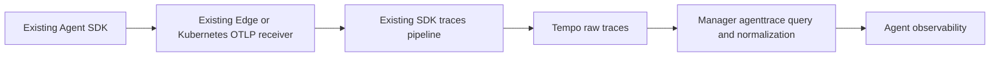

# RFC-005: Agent observability, first version

Status: implemented locally, awaiting review. Date: 2026-10-14.

## Problem and scope

The existing Traces page can show OTLP spans, but cannot group Agent runs and
conversations or explain model usage across SDK schemas. The APM service query
requires server/consumer spans, which excludes many outbound-only Agent workers.

Add a dedicated Agent observability page with a dense run table, execution tree,
input/output inspector, scoped conversations, collection diagnostics and setup.
Use existing Ongrid components and light/dark themes. The layout takes inspiration
from LangSmith. No new collector, database, SDK, billing engine or UI dependency.

## Data flow

The production ingestion path is unchanged. Agent telemetry does not pass through
Manager Go handlers or the Kubernetes controller. OBI remains useful for network
context; it cannot supply missing local tool calls, messages or conversation IDs.

The new `internal/manager/biz/agenttrace` module uses the existing `tracequery`
client. The server exposes authenticated GET APIs under
`/api/v1/agent-observability`. External SDK telemetry retains the deployment-wide
access model; SDK application/session filters do not identify an Ongrid user.
Built-in Ongrid chat telemetry is private to its session owner, with the same
admin read exception as the chat API. A shared querier enforces this boundary for
Agent, Traces, APM and AI Trace tools before returning summaries or raw content.
Every referenced built-in session must be authorized; mixed-owner traces are
withheld as a whole. Unknown, deleted or unresolved built-in sessions fail closed
for ordinary users. Background callers without a user identity cannot read them.

## Semantic contract

| Object | Identity and behavior |
| --- | --- |
| Application | `service.name`, `service.namespace`, environment |
| Run | Trace ID plus entry span ID; one trace may contain several runs |
| Step | Original span ID and parent; agent, workflow, model, tool, retrieval, embedding, reranker or generic span |
| Session | Application identity plus the SDK session/thread ID |
| Content | Structured value with source attribute; unavailable content stays unknown |
| Usage | Nullable values; zero remains zero; only reported costs, no price inference |

Keep instrumentation scope, resource attributes, custom spans, events, links and
raw spans. Missing parents and cycles produce diagnostics; repair only the display
edge. Span Links remain explicit links. Do not infer edges from time proximity.
The run status follows its entry span, so a failed tool followed by recovery does
not automatically make the run fail. An unset status remains unset.

LangSmith `trace.session_id` is a project ID, not a conversation ID. Conversation
grouping uses its metadata thread/session fields. Conflicting session identifiers
withhold grouping. Token aggregation considers model/embedding spans and withholds
conflicting or overlapping usage instead of adding wrapper totals twice. Missing
usage on a model call leaves the corresponding aggregate unknown.

SDK recognition covers LangSmith, OpenInference, OpenLLMetry, Langfuse and common
OTel GenAI attributes. The tested SDK/framework matrix is in the acceptance
[README](../../scripts/agent-observability/README.md). Compatibility is limited to
the tested versions; retained raw data makes future adapter changes possible.

## Query and capacity limits

- Search a maximum seven-day window with fixed semantic markers; do not require
  `kind=server`. Escape user-selected resource values.
- Read at most 50 candidate traces, with four detail reads in flight globally.
  Limit each handler to four simultaneous requests and a 25-second deadline.
- Normalize at most 20,000 spans and 1,000 resource groups per trace.
- Return at most 500 run summaries / 2 MiB, with bounded summary fields. The UI
  pages the same response locally; refreshing starts a new query.
- Return `partial`, reasons and per-trace failures when known limits are reached.
  Sampling remains unknown. Counts and sessions cover retrieved results only.
- Ownership filtering can return fewer results than the candidate limit. Agent
  metadata retains its partial flag when the upstream search reaches its bound
  or a candidate cannot be read, without returning unverified trace IDs.
  Generic Trace search parameters, response fields and Tempo metrics stay as
  before; unauthorized built-in Agent summaries are withheld. Ordinary Trace
  tag dictionaries (including service and operation names) stay deployment-wide.
  Only built-in conversation/worker IDs, input/output, active skill prompts and
  Langfuse status/metadata content use authorized traces for suggestions, bounded
  to 50 recent candidates and 1,000 values of 1,024 bytes each. They are not a
  complete history. Model names, token counters and other ordinary tags retain
  the original global dictionary.
- The existing Tempo HTTP client retains its 16 MiB response limit, now detecting
  overflow explicitly rather than silently truncating JSON. Tempo's configured
  storage limit is separate; larger traces can exist but exceed this query limit.

Filters such as SDK/model are applied to decoded runs because values can occur
on different child spans. The UI applies its secondary filters to the retrieved
result set. Complete historical conversation search and exact global statistics
would require a separate index and are outside this version.

## Setup and content handling

The setup flow resolves the existing Kubernetes receiver without requiring APM
traffic. Linked host processes reuse the existing process-aware receiver resolver.
An unresolved host requires an explicit Collector URL. Manager never probes a
user-provided URL and never returns Edge credentials.

Generate versioned Python smoke examples with a standard OTLP HTTP exporter.
The examples do not call paid models. Use one instrumentation stack per process.
Langfuse's local placeholders verify trace export only; they do not replace a
Langfuse account for its other APIs.

Prompt/tool content follows SDK capture and masking settings. Render supported
messages as escaped Markdown, without evaluating HTML or loading remote media;
keep the original JSON accessible. Responses use `no-store`.
No prompt or credential is added to logs. Operators must configure content
collection/redaction at the existing SDK/Collector before production use.

## Rollout and deferred work

No database migration is needed. Deploy the Manager and web bundle together
after review. The bundled Tempo configuration raises the attribute limit to
16 KiB; built-in content capture remains opt-in as described below. Existing
`/traces` and `/apm` remain available. The Agent page is accessible directly at
`/agent-observability`, without a sidebar, menu-management or command-palette entry.
This local acceptance does not deploy either production service.

Defer evaluation, prompt management, automatic injection, all-language SDK
certification, long-term session indexing and provider price calculation.

## Trace inspector refinement

The October 14 UI pass references LangSmith's [public Trace example](https://smith.langchain.com/public/5ddee370-d49e-4c80-ae12-691aa17c1aa8/r/01a11705-8afa-7990-91d3-87eac3e19c2c)
and its [observability concepts](https://docs.langchain.com/langsmith/observability-concepts).
It keeps Ongrid's components, theme tokens and application identity model.

- A compact run header gives the execution tree and step detail more vertical space.
- Tree and waterfall views share selection, filtering and collapse state. Waterfall
  bars use a common time origin; navigation follows the visible step order.
- The right pane presents input, output and attributes in one scrollable document.
  Sticky section links open and navigate to a section; each section and all sections
  can collapse. Parent links and previous/next controls retain the trace context.
- Input and output independently select Markdown, Plain, JSON or YAML. Markdown
  and Plain retain message roles; JSON/YAML preserve the complete original value,
  including extra fields and scalar types. YAML uses the existing js-yaml library,
  promoted to a direct runtime dependency. Copying JSON/YAML preserves that format.
- Attributes appear as grouped key/value rows with per-field copying. Structured
  and long values expand on demand; raw spans remain accessible. Content formatting
  does not execute HTML or load remote images.
- Existing metadata, events, Span Links, raw spans and related APM/log links remain
  available. Trace content does not cause model calls or remote media requests.

## Built-in Ongrid Agent tracing

The graph runtime uses the official [Eino Langfuse v2 callback](https://github.com/cloudwego/eino-ext/tree/main/callbacks/langfuse/v2)
(`v2.0.2`, with Eino `v0.9.14`) for graph, model and tool lifecycle spans. The
callback receives Manager's existing OTel `TracerProvider`; it requires no
Langfuse server, account or separate exporter. All spans use the existing bounded
OTel batch exporter, Tempo destination and Manager sampling configuration.

The coordinator and workers add `gen_ai.operation.name=invoke_agent` and session
identity. The resolved provider client adds model/provider/token metadata to the
callback's model span, without creating a second model span or counting tokens
twice. The legacy Agent and non-Eino client paths retain small fallback spans.
The adapter snapshots ordinary errors before the official callback reads them
asynchronously, avoiding a race with Eino's mutable error node path.

Workers retain their parent trace, including detached background workers. Their
`gen_ai.conversation.id` is the root session; `ongrid.agent.session.id` identifies
the worker transcript. Background workers do not inherit request cancellation or
Eino callback state. Graph errors that produce a successful apology response are
still marked as trace errors.

Built-in content capture is opt-in with
`ONGRID_AGENT_TRACE_CAPTURE_CONTENT=true`. Built-in content follows chat ownership
on every Manager query path. Administrators retain access to all stored traces.
Operators must still configure appropriate collection and retention policies.
Both query APIs return `Cache-Control: no-store`.

With capture enabled, the Agent root records its current question and final
answer at execution time; the official callback records model and tool snapshots.
The legacy model/tool path uses the same sanitizer. Querying the observation page
reads captured content from Tempo and resolves ownership from chat session rows.
It does not match message timestamps or backfill old traces. Deleting a chat does
not erase its captured trace from Tempo, but removes the ownership evidence, so
ordinary users can no longer query that trace. Administrators retain access until
the telemetry expires. In-progress built-in traces without their root session
metadata are also withheld until ownership can be established.

The content policy has explicit, independent bounds:

- Each serialized input or output is at most **8 KiB**, including its envelope.
- Eino callback attributes have a **24 KiB per-span** budget; usage remains
  independent of the retained text. The existing OTel trace sampling ratio also
  controls volume; it is not a content-size limit.
- Model inputs retain at most **12 recent non-system messages**. System/developer
  instructions retain only their role, byte size and SHA-256 hash.
- Reasoning bodies and media are omitted. Common credential fields, bearer values
  and inline passwords are masked before export. This is not a universal PII
  detector; deployments with additional sensitive formats need their own policy.
- Graph/Lambda implementation spans retain execution metadata without duplicate
  input/output bodies.
- Truncation keeps valid JSON and UTF-8. A versioned snapshot envelope reports the
  original serialized byte size, omitted categories and whether a preview replaced
  the value. The reader preserves the raw span and attributes while exposing those
  limits in the UI. Copying a preview never implies that full content was retained.
- The bundled Tempo attribute cap is **16 KiB**, above the SDK payload budget, so
  it does not split those JSON values. Existing per-trace, ingestion-rate and
  retention limits still apply. The limits here are Ongrid policy, not universal
  OpenTelemetry defaults. Operators using another Tempo must align its cap too.

Reference: [OpenTelemetry GenAI content capture](https://github.com/open-telemetry/semantic-conventions-genai/blob/main/docs/gen-ai/gen-ai-spans.md),
[Langfuse masking](https://langfuse.com/docs/observability/features/masking), and
[Tempo attribute limits](https://grafana.com/docs/tempo/latest/troubleshooting/out-of-memory-errors/).

The Agent observation HTTP routes are excluded from inbound request tracing.
Their existing Tempo client suppression also prevents outbound query spans and
trace-context propagation. Refreshing the observation UI cannot start an Agent:
the query handler only reads Tempo and never calls the runtime or LLM client.
Regression tests exercise a real graph against a local fake model, a tool call,
stream callback completion, content masking, exact token aggregation, soft model
failure, detached worker ancestry/cancellation, and repeated observation reads
with zero generated spans. An optional `ONGRID_AGENT_TRACE_SMOKE_OTLP` endpoint
exports only those synthetic test spans as service `ongrid-eino-smoke`, with
`ongrid.test.synthetic=true`, for local Tempo acceptance.
