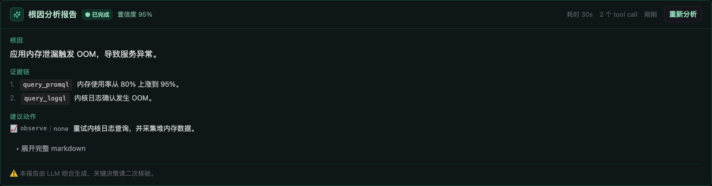
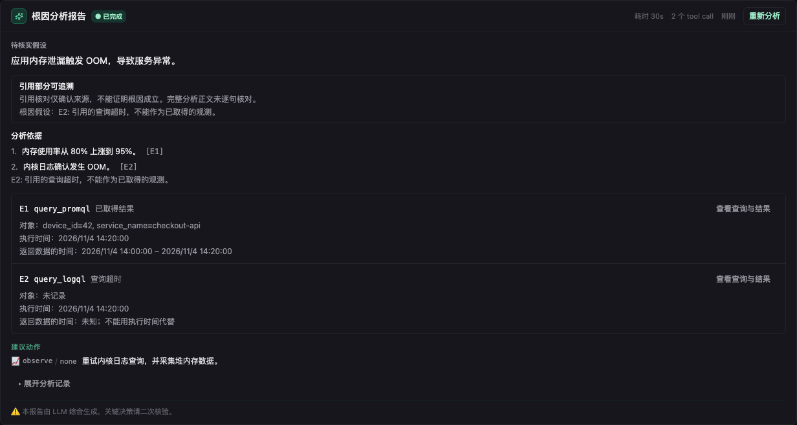

# RFC-010: RCA evidence provenance

Status: implemented on the feature branch; runtime acceptance is tracked separately.

## Problem and boundary

The investigation extractor used only the worker narrative to populate evidence.
Its fallback promoted the first paragraph to a root cause even when extraction
failed. Reports could look complete without a link to an actual observation.

This change checks the provenance of the structured root-cause hypothesis and
evidence items. It does not prove causality or check every sentence of the saved
narrative. A valid citation is not a calibrated confidence score. No automatic
remediation or additional investigation loop is introduced.

## Data flow

After a worker returns, read its persisted tool executions and descendants along
actual `parent_session_id` edges. Reject owner mismatches; do not select unrelated
sessions merely because they contain the same `root_session_id`. Database tool
call IDs identify executions, since model call IDs can repeat.

Assign report-local E1/E2 IDs, split supported host-tool batches by target, and
pass a bounded, credential-masked observation catalog to the existing extraction
call. The extractor emits `root_cause_source_ids` and evidence `source_ids`.
Code checks these against that catalog and persists a versioned `evidence_check`.
Unknown IDs and failed/missing executions never count as obtained observations.
Successful empty results remain distinct from errors and do not prove health.

Initial structured support covers `query_promql`, `query_logql`,
`get_host_processes`, `get_host_load`, and `host_bash`. Other tools are explicitly
marked unsupported/context-only. Model-supplied tool names/statuses are not trusted.
Observed sample timestamps are displayed separately from execution time. An
unknown target or sample window remains unknown.

Limits: 32 sessions, 128 executions, 64 sources, 32 KiB per stored result read,
12 KiB of additional observation catalog input, and a three-second read timeout.
Record, preview, or prompt truncation makes completeness explicit. The report
extractor keeps its existing provider, model, timeout and single-call behavior.
Oversized arguments/results and potentially truncated error summaries are
omitted before redaction; partial JSON cannot be safely masked. Complete fields
remain available. Errors at the runtime's 512-character cap are treated as
potentially truncated, including copies of errors from otherwise complete results.
Evidence reads and extraction have their own bounded timeouts after the worker
finishes, so the worker's elapsed time does not consume the extraction budget.

## Storage, API, and permissions

Add a nullable `investigation_reports.evidence_check_json` through the existing
GORM migration. Extend evidence items without changing the existing array shape.
Historical reports remain unchecked; there is no inferred backfill. Original
results stay in the chat tables with their existing deletion lifecycle; report
metadata contains no duplicate raw log payload.

`GET /v1/alerts/incidents/{id}/investigation/{reportID}/evidence/{sourceID}`
resolves a reference from that exact current report, then checks its execution's
membership in the investigation subtree and its owner. The incident read policy
is preserved. Unlike incident metadata, original system-owned transcripts are
admin-only; user-owned transcripts are available to their owner/admin, matching
chat access. No arbitrary session or call ID is accepted from the request.
Responses use `Cache-Control: no-store`; common credential keys and inline forms
are masked. This masking is not a universal PII classifier. Missing/deleted
sources and regenerated reports return unavailable rather than a fabricated
replacement. A completion after the snapshot is not substituted for that snapshot.

## User experience and compatibility

Report lifecycle (`ready`) and reference status are independent. The UI calls the
conclusion a hypothesis, reports partial/unverified/incomplete references, and
loads saved arguments/results only when expanded. Model confidence is labeled
self-assessment in the analysis record, not measured accuracy. Historical reports
show unchecked status. Extraction failure preserves narrative without promoting
its first line into a root cause.

The new server's wire fields are additive; the matching frontend is needed to
display the check. Roll out the bundled manager/frontend together. Older clients
ignore the new fields. Rollback restores the previous binaries/frontend and leaves
the nullable column in place; older versions resume the previous unverified
presentation. No data deletion is required.

## Verification

Regression cases cover delegated observations, invalid/foreign references,
duplicate provider IDs, partial batch failure, empty vs failed results, bounds,
deleted sources, regeneration, transcript access, redaction, nullable migration,
and extractor fallback. A controlled comparison uses the same memory-pressure
incident, saved observations and scripted model answer on baseline and new code.
The scripted answer incorrectly cites an OOM log whose query timed out. This
comparison demonstrates reference checking, not live-model diagnostic accuracy.

Reproduce the old/new extraction comparison without a provider key:

```sh
python3 scripts/replay_rca_evidence.py /tmp/ongrid-rca-replay
```

The script compiles the actual extractor from commit
`6b7ee6258fde6f7157c96bb15ce731b082cde122` alongside the current implementation,
renaming symbols only, and removes the temporary test file afterward. Both receive
the same intentionally incorrect structured answer. Outputs include `old.json`,
`new.json`, and bounded source details. In this fixture both versions make one
extraction call; the new catalog adds 1,097 bytes. This is not a token billing or
production latency measurement.

Browser regression: `web/e2e/investigation-evidence.spec.ts` covers on-demand source
loading, long fields, and 390/768/1280/1920px in Chinese/English and light/dark.
With a local Vite server, run from `web`:

```sh
E2E_BASE_URL=http://127.0.0.1:5178 E2E_BROWSER_CHANNEL=chromium \
  npm run test:e2e -- --project=chromium --no-deps e2e/investigation-evidence.spec.ts
```

Local validation passed the affected Go packages with race detection, manager
bootstrap tests, six component tests, the frontend build/lint (45 existing lint
warnings), and all 16 browser combinations. The all-package Go run is not green
on macOS: Linux-only Edge symbols/cmdpolicy and an existing upgrade-path case test
fail. Architecture lint v1.19.0 passes on a copy of the current tracked files;
the development checkout's `node_modules` contains unrelated Go sources.
Regression tests also cover oversized field omission at the SQL reader and
prompt/detail boundaries, complete LogQL arguments, failed-batch targets, and
the extractor's independent deadline. These pass with race detection.
MySQL migration/runtime, real providers, and production rollout remain untested.

## Controlled UI comparison

Both screenshots use the same deliberately incorrect model answer and saved
observations. The baseline labels the answer as a root cause with 95% confidence;
the new report labels it as a hypothesis and identifies the timed-out OOM query.
The displayed 30-second duration is fixture data, not a performance measurement.

Before:



After:


